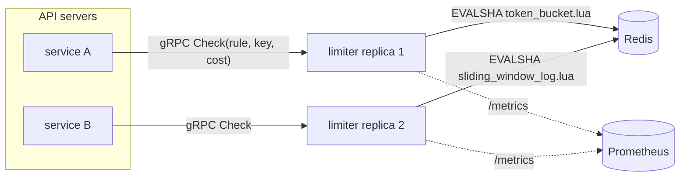

# Distributed Rate Limiter

**A gRPC rate-limiting service that stays exact across replicas: token bucket, sliding window log and sliding window counter, each executed as one atomic Redis Lua script.**


[](https://github.com/Alkarim786/distributed-rate-limiter/actions/workflows/ci.yml)
[](LICENSE)

---

## Why this exists

Every public API needs rate limiting: to stop abuse and credential stuffing, to share capacity fairly between tenants, and to protect downstream services. Limiting inside each API server breaks as soon as you scale out. With N servers, each one's local counter lets a client through N times the limit.

This project is a **standalone limiter service**. API servers ask it "may user X do this now?" over gRPC. All state lives in Redis, and every decision is **one atomic Lua script** that reads Redis's own clock. So any number of limiter replicas can serve traffic and the limit stays exact. The integration tests prove it.

## Architecture



**Request flow**
1. The client calls `Check{rule: "api-per-user", key: "user-42", cost: 1}`.
2. The service validates the request (unknown rule → `NOT_FOUND`; empty key, negative cost, or cost above the limit → `INVALID_ARGUMENT`).
3. It builds the storage key `rl:{api-per-user:user-42}`. The braces are a Redis Cluster hash tag, so a key's state always lives on one shard.
4. It runs the rule's Lua script with `EVALSHA` (falling back to `EVAL` on `NOSCRIPT`). The script reads `TIME`, updates state, sets a TTL and returns `{allowed, remaining, retry_ms, reset_ms}` in one round-trip.
5. If Redis errors or exceeds `REDIS_TIMEOUT`, the configured policy applies: **fail-open** (allow and count `ratelimit_backend_errors_total`) or **fail-closed** (`UNAVAILABLE`).

## Algorithms

| Algorithm | State per key | Exact? | Best for |
|---|---|---|---|
| **Token bucket** | 2 numbers (tokens, last refill) | yes, for rate + burst | Normal API limits: smooth rate, tolerates short bursts |
| **Sliding window log** | 1 entry per admitted unit (≤ limit) | yes, no boundary bursts | Low limits on sensitive actions (login attempts, OTP sends) |
| **Sliding window counter** | 3 numbers (window, current, previous) | approximate (weighted) | High-volume limits where O(1) memory matters (per-IP) |

The arithmetic lives in [`internal/limiter/algorithms.go`](internal/limiter/algorithms.go). The Lua scripts in [`internal/limiter/scripts/`](internal/limiter/scripts) are line-for-line ports. A test replays 6,000 random operations against both backends with the same clock and requires **identical decisions**, so the in-memory and Redis implementations can't drift apart.

## Tech stack

| Tech | Why |
|---|---|
| **Go** | Cheap goroutines for high-concurrency I/O, small static binaries, first-class gRPC |
| **gRPC + protobuf** | Typed contract, HTTP/2 multiplexing, low per-call overhead; health and reflection built in |
| **Redis + Lua** | Single-threaded script execution gives atomic read-modify-write without WATCH/MULTI retry loops; server `TIME` gives replicas one clock |
| **go-redis v9** | Script helper handles EVALSHA/NOSCRIPT, pooling, and works with Cluster/Ring clients |
| **Prometheus client** | Decision counters, latency histogram and backend errors for alerting |
| **miniredis** | Runs the real Lua scripts in-process, so tests are fast, hermetic, and can control time |
| **distroless** | Non-root runtime image with no shell (52 MB as reported by `docker image ls`) |

## Features

**Implemented**
- 3 algorithms × 2 backends (Redis for distributed use, sharded in-memory for single node and tests)
- gRPC `Check` and `ListRules`, the gRPC health service, and server reflection (works with `grpcurl`)
- Variable `cost` per request (heavy endpoints can consume more)
- Accurate `retry_after_ms` and `reset_after_ms` (tests check that waiting exactly `retry_after` succeeds)
- Rules in YAML, settings in env vars ([`.env.example`](.env.example))
- Fail-open / fail-closed policy with a per-call Redis timeout
- TTLs on every Redis key, plus an in-memory sweeper, so memory stays bounded
- Prometheus metrics on `:9090/metrics`, `/healthz`
- Graceful shutdown (drains in-flight RPCs)
- A load generator (`cmd/loadtest`) and Go benchmarks
- Docker image + compose stack (Redis + 2 replicas), GitHub Actions CI (race detector, real-Redis integration tests, image build)

**Roadmap**
- Local token leasing: each replica grabs a batch of tokens to cut Redis round-trips for hot keys
- Hierarchical limits (user ∧ org ∧ global) in one call
- Envoy `ratelimit.v3` API adapter so Envoy/Istio can use it directly
- Hot reload of rules on file change
- Redis Sentinel / Cluster deployment examples

## Key engineering decisions

- **Atomicity via Lua, not locks.** Redis runs a script to completion before serving anything else, so the read-refill-check-write sequence can't interleave between replicas. The alternative (WATCH/MULTI) retries under contention, which is exactly when a limiter is busiest.
- **One clock.** Scripts call `redis.call('TIME')` instead of trusting each replica's clock. Two replicas with 300 ms of clock skew still make consistent decisions.
- **Bounded memory.** Every script sets a TTL (refill time, or window + 1 s), so abandoned keys vanish. The sliding log is O(limit) per key, which is why it's reserved for low limits. The counter variant is O(1).
- **Floating-point care.** `1000 × (1 − 0.7)` is `300.00000000000006` in IEEE-754; a naive `ceil` returns 301 ms. Both Go and Lua use `ceil(x − 1e-9)`. A unit test caught this.
- **Fail-open by default.** If the limiter's Redis dies, refusing all traffic would turn a limiter outage into a full outage. Fail-closed is one env var away for auth or payment endpoints.
- **Validation at the edge.** `cost > limit` can never succeed, so it's rejected with `INVALID_ARGUMENT` instead of returning a misleading retry-after.
- **Sharded in-memory backend.** 64 mutex shards keyed by FNV hash keep unrelated keys from contending, giving 85 ns/op across 8 threads.

## Quick start

```bash
docker compose up --build -d          # Redis + limiter-1 (:50051) + limiter-2 (:50052)
docker compose run --rm loadtest      # 15 s load test across both replicas, from inside the network
```

Try it with [grpcurl](https://github.com/fullstorydev/grpcurl) (reflection is enabled):

```bash
grpcurl -plaintext -d '{"rule":"login-attempts","key":"alice"}' localhost:50051 ratelimit.v1.RateLimiter/Check
```

## Local development

```bash
go test -race ./...                                   # all tests (miniredis, no Docker needed)
docker run -d -p 6379:6379 redis:7.4-alpine
REDIS_TEST_ADDR=localhost:6379 go test -run 'Distributed' ./internal/limiter/   # against real Redis
BACKEND=memory go run ./cmd/server                    # or BACKEND=redis REDIS_ADDR=localhost:6379
go run ./cmd/loadtest -addr localhost:50051 -c 64 -d 10s
```

Regenerate protobuf code after editing `proto/`:
```bash
protoc -Iproto --go_out=gen --go_opt=paths=source_relative --go-grpc_out=gen --go-grpc_opt=paths=source_relative proto/ratelimit/v1/ratelimit.proto
```

## API reference

### `ratelimit.v1.RateLimiter/Check`

Request:
```json
{ "rule": "api-per-user", "key": "user-42", "cost": 1 }
```
Response (allowed):
```json
{ "allowed": true, "limit": "100", "remaining": "99", "resetAfterMs": "600", "algorithm": "ALGORITHM_TOKEN_BUCKET" }
```
Response (denied):
```json
{ "allowed": false, "limit": "5", "retryAfterMs": "812345", "resetAfterMs": "899870", "algorithm": "ALGORITHM_SLIDING_WINDOW_LOG" }
```

| gRPC status | When |
|---|---|
| `NOT_FOUND` | Unknown rule |
| `INVALID_ARGUMENT` | Empty or oversized key, negative cost, cost > rule limit |
| `UNAVAILABLE` | Backend failed and `FAIL_OPEN=false` |

### `ratelimit.v1.RateLimiter/ListRules`
Returns the configured rules (name, algorithm, limit, window_ms).

### Rules file ([`config/rules.yaml`](config/rules.yaml))
```yaml
rules:
  - name: api-per-user
    algorithm: token_bucket          # token_bucket | sliding_window_log | sliding_window_counter
    limit: 100
    window: 1m
```

### Metrics
`ratelimit_decisions_total{rule,result}` (`allowed` / `denied` / `fail_open`), `ratelimit_check_duration_seconds{backend}`, `ratelimit_backend_errors_total{rule}`, plus Go runtime and process metrics.

## Testing

```bash
go test -race -count=1 ./...
```

25 tests (including subtests) cover:
- **Algorithm behaviour** with a fake clock: burst then refill, cost > 1, exact log expiry, no boundary burst, counter weighting, and **retry-after honesty** (waiting exactly `retry_after` must succeed), for all three algorithms.
- **Redis ≡ memory:** 6,000 random operations, identical decisions.
- **Distributed correctness:** 3 replicas × 40 goroutines × 10 requests on one hot key must admit exactly the limit, per algorithm. Runs on miniredis by default and on real Redis with `REDIS_TEST_ADDR`.
- TTLs expire, the backend-down path, the gRPC server over `bufconn` (validation codes, fail-open/closed, metrics), and config parsing.

CI runs everything with `-race`, then again against a real Redis service container, then builds the Docker image.

## Benchmarks

All numbers were **measured on 2026-10-19** on one laptop: **AMD Ryzen 5 7520U (4 cores / 8 threads), 16 GB RAM, Windows 11**. Docker Desktop 29.8.2 on WSL2. Redis 7.4-alpine with persistence off. The load generator, the limiter replicas and Redis all share that one CPU, so these are **lower bounds**, not production capacity.

### In-process algorithm cost (`go test -bench`, 10,000 keys)

| Algorithm | 1 thread | 8 threads (parallel) | allocs/op |
|---|---|---|---|
| Token bucket | 316 ns/op | 86 ns/op | 1 |
| Sliding window counter | 377 ns/op | 84 ns/op | 1 |
| Sliding window log (limit 100) | 672 ns/op | 125 ns/op | 1–2 |

### End-to-end gRPC (`cmd/loadtest`, inside the Docker network, 1,000 keys, 15 s after a 2 s warm-up)

| Setup | Concurrency | Throughput | p50 | p90 | p99 | Errors |
|---|---|---|---|---|---|---|
| Memory backend, 1 replica | 64 | 18,044 req/s | 2.74 ms | 6.56 ms | 13.1 ms | 0 |
| Redis backend, 1 replica | 64 | 9,103 req/s | 6.39 ms | 10.7 ms | 17.8 ms | 0 |
| Redis backend, 2 replicas | 64 | 7,221 req/s | 7.82 ms | 14.6 ms | 25.6 ms | 0 |
| Redis backend, 1 replica | 8 | 3,113 req/s | 2.27 ms | 3.60 ms | 8.37 ms | 0 |
| Redis backend, 1 replica | 1 | 566 req/s | 1.74 ms | 2.04 ms | 2.56 ms | 0 |

**Reading these honestly:** the second replica *lowers* throughput here because all five processes compete for the same 4 cores. Horizontal scaling only pays off on separate machines. The useful results are the per-request cost at low concurrency (about 1.7 ms through gRPC → limiter → Redis, inside Docker's virtual network) and that there were **zero errors** under load.

### Correctness under load

| Test | Requests | Admitted | Expected |
|---|---|---|---|
| `login-attempts` (5 per 15 min), 5 keys, 2 replicas, 32 workers, 5 s | 31,075 | **25** | 25 |
| Integration test on real Redis: 3 replicas × 40 goroutines × 10, limit 150, per algorithm | 1,200 each | **150** each | 150 |

How to reproduce: `docker compose up --build -d`, then `docker compose run --rm loadtest -addr limiter-1:50051 -c 64 -d 15s`.

## Project structure

```
.
├── cmd/
│   ├── server/          # gRPC server: config, backend wiring, metrics, graceful shutdown
│   └── loadtest/        # concurrent load generator with latency percentiles
├── internal/
│   ├── limiter/         # algorithms, memory + Redis backends, Lua scripts, tests, benchmarks
│   │   └── scripts/     # token_bucket.lua, sliding_window_log.lua, sliding_window_counter.lua
│   ├── server/          # RateLimiter gRPC service (validation, fail-open/closed)
│   ├── config/          # env config + YAML rules
│   └── metrics/         # Prometheus collectors
├── proto/ratelimit/v1/  # API contract
├── gen/ratelimit/v1/    # generated protobuf/gRPC code
├── config/rules.yaml
├── Dockerfile · docker-compose.yml · .github/workflows/ci.yml
```

## License

[MIT](LICENSE) © Karim (Alkarim786)
